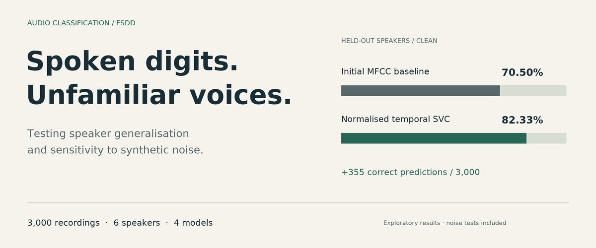
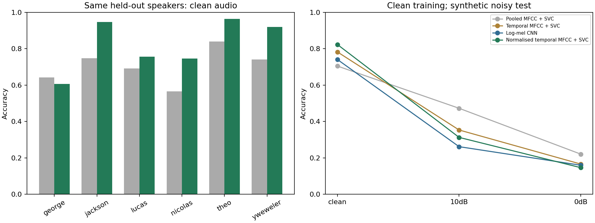
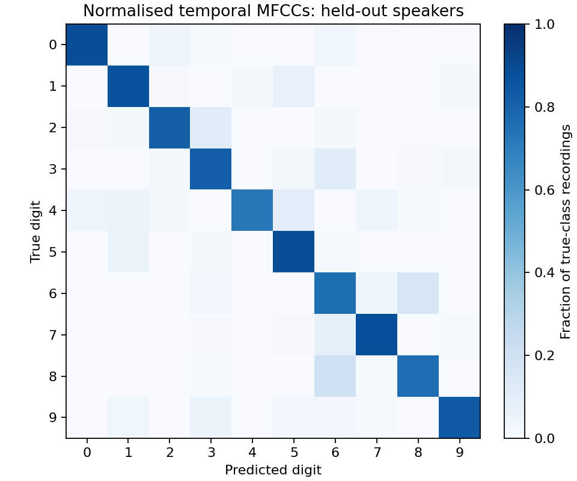

# Spoken digits: speaker generalisation and noise



How much does a digit classifier depend on the person speaking? This small FSDD
study starts with pooled MFCC features, then tests whether keeping the order of
sounds within a word improves recognition of a speaker excluded from training.

The strongest clean-audio follow-up reaches **82.33%** on unseen speakers,
compared with **70.50%** for the initial baseline. It is less robust to synthetic
noise. Both results are retained; the experiment does not identify a model that
is best in every condition.

The task is to recognise isolated English digits from zero to nine. No
conversation detection, EEG, listening effort or attention estimation is involved.

[Visual report (HTML)](docs/index.html) · [Learning notebook](walkthrough.ipynb) ·
[Recorded results](results/normalized.json) · [Source review](SOURCE-REVIEW.md)

The visual report has interactive model comparisons and the evaluation design.
Download the repository and open `docs/index.html` in a browser to view it;
GitHub displays the HTML source. This README is the repository landing page.

## What was compared

The data are FSDD v1.0.10: 3,000 recordings, six speakers, 8 kHz. Downloads are
pinned to commit `d6938f9bf1545aa66d8489fc9f1385a7abd64282`; the archive hash is
in [metrics.json](results/metrics.json). Audio is downloaded separately.

All representations start from 25-ms frames, spaced 10 ms apart. The MFCC
calculation uses 26 mel filters and coefficients 1–13, dropping coefficient 0.

- **Pooled MFCC + SVC:** means and standard deviations of MFCCs and their first
  and second differences, plus duration. This is the initial 79-feature baseline
  with fixed RBF SVC regularisation `C=10`.
- **Temporal MFCC + SVC:** each coefficient is interpolated to 32 ordered time
  points, giving 416 features. SVC regularisation is selected within the training
  speakers.
- **Log-mel CNN:** 26 log-mel bands interpolated to 64 time points, followed by a
  small three-block 2D convolutional network. One training speaker selects the
  number of epochs; the model is then refitted on all outer-training speakers.
- **Normalised temporal MFCC + SVC:** the 416-feature representation is
  standardised across the 13 coefficients within each time frame. This
  normalisation uses each clip alone. It is different from conventional CMVN
  over the time axis.

The follow-ups were motivated by existing FSDD examples that preserve temporal
structure. [SOURCE-REVIEW.md](SOURCE-REVIEW.md) records their reported scores,
splits, methods and the source code inspected. Our implementations are not exact
reproductions of those projects.

## Evaluation

The official recording-index split tests recordings 0–4 and trains on 5–49.
Every speaker appears in both sets. Separately, six leave-one-speaker-out folds
train on five voices and test on the sixth. Each of the 3,000 clips receives one
prediction from a model trained without its speaker.

For the temporal SVCs, `C` is selected from `[1, 10, 100]` by inner
leave-one-speaker-out validation on the training speakers. Scaling stays inside
the training pipeline. CNN epoch selection also excludes the outer test voice.
The recording-split temporal SVC uses fixed `C=10`; the normalised SVC selects it
using only the 2,700 training recordings, grouped by speaker. The recording-split
CNN runs for a fixed 30 epochs.

Every model trains on clean audio. At test time, independent Gaussian noise is
added at 10 dB and 0 dB SNR. The seeded noisy waveforms are the same across models.
There is no noise augmentation or realistic background-sound dataset.

## Measured results

| Model | Known speakers: recording split | Unseen speakers: clean | Unseen speakers: 10 dB | Unseen speakers: 0 dB |
|---|---:|---:|---:|---:|
| Pooled MFCC + SVC | 96.33% | 70.50% | 47.30% | 22.10% |
| Temporal MFCC + SVC | 99.33% | 78.27% | 35.37% | 16.63% |
| Log-mel CNN | 99.00% | 74.10% | 26.20% | 16.00% |
| Normalised temporal MFCC + SVC | 99.00% | **82.33%** | 31.30% | 14.67% |

Across the 3,000 held-out-speaker predictions, the clean result increases from
2,115 correct predictions to 2,470: 355 more correct predictions, or 11.83
percentage points.

The normalised temporal model improves clean accuracy for five of the six held-out
speakers. For George, accuracy falls from 64.2% to 60.6%. Its pooled clean macro F1
is 0.8258, compared with 0.7064 for the baseline.

That gain is specific to clean recordings. At 10 dB SNR, its accuracy falls below
the baseline by 16 percentage points. Keeping temporal detail may be useful, but
this comparison changes several things at once and cannot isolate the cause of
either the gain or the loss. Noise-aware training is a possible next experiment.





Full precision, per-speaker metrics and tuning choices are saved in
[metrics.json](results/metrics.json), [comparison.json](results/comparison.json)
and [normalized.json](results/normalized.json). The initial results and predictions
were reproduced after refactoring feature extraction; every value was unchanged.

## Reproduce

Tested with Python 3.12.4, PyTorch 2.4.1 and the versions in `requirements.txt`.
From this directory:

```sh
python3 -m venv .venv
source .venv/bin/activate
python -m pip install -r requirements.txt
python study.py --download
python compare.py
python normalized.py
python checks.py
```

Run the scripts in that order. `compare.py` creates a feature cache for the
follow-ups; the cache and intermediate progress file are excluded from sharing.
The checks recompute all saved follow-up scores, check prediction coverage and
speaker separation, and verify normalisation and noise calibration.

[walkthrough.ipynb](walkthrough.ipynb) contains audio playback, feature examples
and a comparison of mistakes. The [visual report](docs/index.html) summarises the study in English.
Notebook software is optional and installed separately.

## Limits

These are descriptive results from six speakers, with variation in voices,
accents and recording conditions that this study does not separate. Development
used this same dataset: the normalisation follow-up was tried after inspecting
other models' results. Although tuning excludes outer test voices, the reported
scores are exploratory development evidence, not an untouched final evaluation.

A larger, independent speaker sample and realistic noise tests would be needed
before making claims about performance on everyday wearable recordings. The
clean-audio gain is a useful result for this exercise, not evidence of clinical
validity or a new algorithm.

## Sources and assistance

- [FSDD](https://github.com/Jakobovski/free-spoken-digit-dataset), by Zohar Jackson
  and contributors. Dataset license: CC BY-SA 4.0.
- [MathWorks spectrogram CNN example](https://es.mathworks.com/help/signal/ug/spoken-digit-recognition-with-custom-log-spectrogram-layer-and-deep-learning.html),
  the reference for the log-spectrogram CNN approach.
- [Aniruddha Pal's MFCC/BiLSTM project](https://github.com/aniruddhapal211316/spoken_digit_recognition),
  whose framewise coefficient standardisation inspired the normalised follow-up.
  Our model uses fewer coefficients, time interpolation and an SVC.
- [Kaldi feature transforms](https://kaldi-asr.org/doc/transform.html), consulted
  for the distinction between framewise coefficient standardisation and CMVN.
- [scikit-learn LeaveOneGroupOut](https://scikit-learn.org/stable/modules/generated/sklearn.model_selection.LeaveOneGroupOut.html)
  and [SciPy DCT](https://docs.scipy.org/doc/scipy/reference/generated/scipy.fft.dct.html).

Code, experiments and explanatory material were prepared with AI assistance.
External implementations were inspected and their method ideas are credited;
no source code or notebook solution was copied. The learning notebook leaves the
user's listening observations open.

Project material and derived figures are shared under CC BY-SA 4.0. Upstream
audio retains its original attribution and license.
